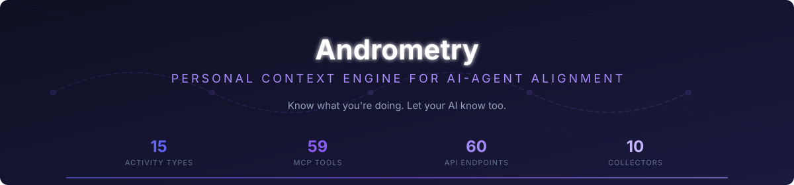

<!-- T2I HERO SPEC — Subject: a personal context engine — a phone (Android) on the left emitting a stream of life signals (app usage, screen state, calendar, location, health, notifications) into a local-first relay server (center), which serves structured context snapshots to an AI agent on the right. Composition: left-to-right signal pipeline; confident, warm minimalism; measurement/regression motif (confidence bars, timestamps). Palette: deep indigo #1e1b4b → electric teal #2dd4bf accent → warm amber #f59e0b for agent intervention. Style: flat vector, dark UI, glowing data flows, no text. 16:9. -->


[](https://github.com/ishan-parihar/andrometry/actions/workflows/ci.yml)


<p align="center">
  
</p>

<p align="center">
  <strong>Personal Context Engine for AI-Agent Alignment</strong><br/>
  <em>Know what you're doing. Let your AI know too.</em>
</p>

<p align="center">
  <a href="https://github.com/ishan-parihar/andrometry/actions"></a>
  <a href="LICENSE"></a>
  
</p>

<p align="center">
  <a href="#quick-start">Quick Start</a> ·
  <a href="#architecture">Architecture</a> ·
  <a href="#api-reference">API</a> ·
  <a href="#mcp-tools">MCP Tools</a> ·
  <a href="#classification-system">Classification</a> ·
  <a href="#deployment">Deploy</a>
</p>

---

**Andrometry** is a local-first, agent-native personal observability system. It collects signals from your Android device — app usage, screen state, calendar, location, health, notifications — and infers your current context with confidence scores. AI agents can query this context to understand what you're doing, when you're focused, when you're distracted, and when to intervene.

```text
┌──────────────────────────────────────────────────────────────┐
│                    Android Collector App                     │
│  Kotlin · Room · WorkManager · Hilt · Health Connect         │
│  Screen · Usage · Notifications · Calendar · Location · Focus │
│                                                              │
│  Inference: Context · Segments · Confidence · Hysteresis     │
│  Storage: Events · Segments · Summaries · Habits · Goals     │
└───────────────────────────┬──────────────────────────────────┘
                            │ HTTPS POST, gzip, token auth
                            │ batched, idempotent, retry-safe
                            ▼
┌──────────────────────────────────────────────────────────────┐
│                    Minimal Context Relay                      │
│  Go · SQLite · Caddy · systemd                               │
│  Auth · Batch Ingestion · Timeline API · Briefing             │
│  Summaries · Observations · Interventions · Feedback          │
│  Goals · Habits · Outcomes · Policy Governor · Audit Log      │
└───────────────────────────┬──────────────────────────────────┘
                            │ HTTPS / MCP tools / SSE
                            ▼
┌──────────────────────────────────────────────────────────────┐
│                        AI Agents                             │
│  Context Polling · Briefing · Timeline · Drill-down           │
│  Observations · Interventions · Outcomes · Habits · Goals     │
│  Alignment Scoring · Risk Detection · Coaching                │
└──────────────────────────────────────────────────────────────┘
```

## Why Andrometry

| Problem | Solution |
|---------|----------|
| AI agents don't know what you're doing right now | Continuous context inference from 10+ signal sources |
| Raw telemetry is noisy and battery-hungry | Semantic summaries — "deep work at office" not raw GPS |
| Agents can't learn from their interventions | Closed-loop: observe → intervene → feedback → recalibrate |
| "Productivity" is subjective | Server-configurable alignment weights via PreferencesBridge |
| Activity oscillation (rapid switching) | 120s temporal hysteresis with sensor bypass |

## How it compares

| Capability | Andrometry | Notion + AI | Rewind / Microsoft Recall | Obsidian + plugins |
|---|---|---|---|---|
| **Agent-native context API** | ✅ REST + MCP + SSE (`/v1/context`, `/v1/briefing`) | ❌ no agent surface | ❌ recall only | ⚠️ manual export |
| **On-device inference** | ✅ 15 activity types, 0.0–1.0 confidence, hysteresis | ❌ cloud AI | ⚠️ device indexing | ❌ |
| **Closed feedback loop** | ✅ observe → intervene → feedback → recalibrate | ❌ | ❌ | ❌ |
| **Privacy default** | ✅ local-first, metadata-only, sensitive mode, kill switch | ❌ cloud sync | ⚠️ on-device but OS-level | ✅ local files |
| **Deploys self-hosted** | ✅ single Go binary + SQLite, $4/mo VPS | ❌ | ❌ | ✅ |
| **Intervention outcomes** | ✅ goals/habits/outcomes tracked against interventions | ❌ | ❌ | ❌ |

Andrometry is the only one of the four built *for agents*: every signal is exposed as a queryable, confidence-scored context object over a scoped-token API — not a chat thread or a file folder.

## What It Tracks

**15 Activity Types** — classified by priority:

| Priority | Activities | Source |
|----------|-----------|--------|
| 1-2 | `sleep`, `meeting` | Sensor signals (high confidence) |
| 3-4 | `exercise`, `commute` | Health + movement data |
| 5 | `deep_work`, `shallow_work`, `learning` | Focus state + app category |
| 6 | `communication`, `social`, `leisure`, `admin`, `planning`, `break`, `distraction`, `unknown` | App category + context |

**Context Snapshot** includes:
- Primary activity + confidence (0.0–1.0)
- Place + place confidence
- Focus state + duration
- Distraction probability
- Fatigue probability (circadian + sleep debt)
- Alignment probability (server-configurable)
- Readiness score
- Data quality signals (completeness, staleness, missing collectors)

---

## Quick Start

### Prerequisites

- **Server**: Go 1.22+
- **Android**: Android SDK (compileSdk 35), Java 17
- **MCP Server**: Node.js 18+

### 1. Start the Relay Server

```bash
cd server
go run ./cmd/andrometry --bootstrap-token=dev-token-123
```

This creates a device token and agent token. The server starts on `:8420`.

### 2. Generate Synthetic Data

```bash
cd scripts
node generate.js --token=dev-token-123 --relay=http://localhost:8420 --date=2026-07-28
```

### 3. Query Context (as an AI agent)

```bash
# Current context
curl -H "Authorization: Bearer agent-dev-token-123" \
  http://localhost:8420/v1/context/current

# Briefing with risks & opportunities
curl -H "Authorization: Bearer agent-dev-token-123" \
  http://localhost:8420/v1/briefing/current

# Today's timeline
curl -H "Authorization: Bearer agent-dev-token-123" \
  "http://localhost:8420/v1/timeline?from=2026-07-28T00:00:00Z&to=2026-07-28T23:59:59Z"
```

### 4. Build the Android APK

```bash
cd android
export JAVA_HOME=/usr/lib/jvm/java-17-openjdk
export ANDROID_HOME=/path/to/android-sdk
./gradlew assembleDebug
# APK: app/build/outputs/apk/debug/app-debug.apk
```

### 5. Run MCP Server (for AI agents)

```bash
cd agents/mcp
npm install
export ANDROMETRY_RELAY_URL=http://localhost:8420
export ANDROMETRY_AGENT_TOKEN=agent-dev-token-123
npm start
```

---

## Architecture

### Design Principles

| Principle | Implementation |
|-----------|---------------|
| **Local-first** | Phone is primary sensing, storage, and inference node |
| **Semantic over raw** | Agents consume context objects, not raw telemetry |
| **Event-driven** | BroadcastReceivers + WorkManager, not continuous polling |
| **Batched sync** | Compressed, idempotent, retry-safe HTTPS uploads |
| **Agent-native** | Context, briefing, timeline, observation APIs |
| **Closed-loop** | Sense → Infer → Expose → Agent → Intervene → Feedback → Recalibrate |
| **Privacy by default** | Metadata only, no content, sensitive mode, kill switch |

### Project Structure

```text
andrometry/
├── docs/architecture/       # Architecture & alignment docs
├── schemas/                 # JSON Schema definitions (events, segments, context, agent, summaries)
├── server/                  # Go relay server
│   ├── cmd/andrometry/      # Main entry point
│   ├── internal/            # Auth, DB, handlers, middleware, models, governor, briefing, audit
│   ├── api/                 # OpenAPI spec
│   └── migrations/          # SQL migrations
├── android/                 # Android collector app
│   └── app/src/main/java/com/andrometry/
│       ├── core/            # Database, network, security, config
│       ├── collectors/      # Screen, usage, notifications, calendar, location, health, focus
│       ├── inference/       # Classifier, segments, context, confidence, baselines, preferences
│       ├── summaries/       # Five-minute, hourly, daily, weekly
│       ├── sync/            # Queue, uploader, idempotency, retry
│       ├── agents/          # Observations, interventions, goals, habits, feedback, outcomes
│       └── ui/              # Permissions, status, debug, inbox, privacy
├── agents/mcp/              # MCP server wrapping relay API as tools
├── scripts/                 # Synthetic event generator
├── test/                    # Synthetic data, golden tests, MCP tests, schema tests
└── README.md
```

---

## API Reference

### Authentication

Bearer tokens with scoped access:

| Token Type | Scopes |
|-----------|--------|
| **Device** | `device:ingest`, `device:read_config`, `device:read_interventions`, `device:write_feedback` |
| **Agent** | `agent:context:read`, `agent:briefing:read`, `agent:timeline:read`, `agent:events:read`, `agent:summaries:read`, `agent:observations:write`, `agent:interventions:write`, `agent:feedback:read`, `agent:goals:read/write`, `agent:habits:read/write`, `agent:outcomes:write` |
| **Admin** | Full access to audit log and preferences |

### Endpoints

| Method | Path | Scope | Description |
|--------|------|-------|-------------|
| `GET` | `/v1/health` | — | Health check |
| `POST` | `/v1/batch` | `device:ingest` | Ingest event batch from device |
| `GET` | `/v1/context/current` | `agent:context:read` | Current context (ETag support for cheap polling) |
| `GET` | `/v1/briefing/current` | `agent:briefing:read` | Agent briefing with risks & opportunities |
| `GET` | `/v1/timeline` | `agent:timeline:read` | Semantic timeline segments |
| `GET` | `/v1/events` | `agent:events:read` | Raw events (drill-down only) |
| `GET` | `/v1/summary/daily` | `agent:summaries:read` | Daily summary |
| `GET` | `/v1/summary/weekly` | `agent:summaries:read` | Weekly summary |
| `POST` | `/v1/agent/observations` | `agent:observations:write` | Write agent observation |
| `POST` | `/v1/agent/interventions` | `agent:interventions:write` | Propose intervention |
| `POST` | `/v1/feedback` | `agent:feedback:read` | Submit user feedback |
| `POST` | `/v1/goals` | `agent:goals:write` | Create goal |
| `POST` | `/v1/habits` | `agent:habits:write` | Create habit |
| `POST` | `/v1/outcomes` | `agent:outcomes:write` | Record intervention outcome |
| `GET` | `/v1/preferences` | `admin` | Get user preferences |
| `PUT` | `/v1/preferences` | `admin` | Update user preferences |
| `DELETE` | `/v1/preferences` | `admin` | Delete preferences |
| `GET` | `/v1/audit` | `admin` | Audit log |

### Agent Query Ladder

Agents should start at the highest abstraction that answers their question:

```text
Level 1: /v1/context/current    ← "What am I doing right now?"
Level 2: /v1/briefing/current   ← "Give me the big picture"
Level 3: /v1/timeline           ← "What happened in the last 2 hours?"
Level 4: /v1/summary/daily      ← "How was my day?"
Level 5: /v1/events             ← "Show me raw app usage details"
```

---

## MCP Tools

The MCP server exposes 59 tools for AI agents:

| Category | Tools |
|----------|-------|
| **Context** | `get_current_context`, `get_current_briefing` |
| **Timeline** | `get_timeline`, `get_focus_sessions`, `get_place_visits`, `get_distraction_segments` |
| **Summaries** | `get_daily_summary`, `get_weekly_summary` |
| **Events** | `search_events` |
| **Agent Loop** | `add_agent_observation`, `propose_intervention`, `record_outcome` |
| **Goals** | `get_goals`, `create_goal` |
| **Habits** | `get_habits`, `create_habit` |
| **Preferences** | `get_preferences`, `update_preferences`, `delete_preferences` |
| **Data Quality** | `get_data_quality`, `get_agent_effectiveness` |
| **Convenience** | 13 additional tools for common agent workflows |

---

## Classification System

### How Activity Classification Works

```text
Priority 1-4 (Sensor-Based — High Confidence):
  sleep     → screen off + night (0-6am) + home + still
  meeting   → calendar busy + not "none"
  exercise  → health activity (walking/running/cycling)
  commute   → movement == in_transit

Priority 5 (Focus-Based):
  deep_work     → focus active + productivity app + low switching
  shallow_work  → focus active + productivity app + high switching
  learning      → focus active + education/browser app

Priority 6 (Category-Based):
  communication → email/communication apps
  social        → social media (distraction if focus active)
  leisure       → entertainment apps
  admin         → system/tools apps
  planning      → calendar apps
  break         → health/shopping apps
  unknown       → unrecognized categories
```

### Temporal Hysteresis

To prevent rapid oscillation between activities (e.g., `social` ↔ `communication`), the engine applies a **120-second cooldown**:

- New activity must be sustained for 2 minutes before it takes effect
- **Sensor-based activities** (sleep, meeting, exercise, commute) bypass cooldown
- When a sensor condition ends (e.g., user wakes up), cooldown is bypassed
- Thread-safe via Mutex for concurrent coroutine access

### Server-Configurable Alignment

The `PreferencesBridge` fetches alignment weights from the server's `/v1/preferences` endpoint:

```json
{
  "baseline": 0.5,
  "focus_bonus": 0.3,
  "productivity_weight": 0.15,
  "education_weight": 0.15,
  "social_penalty": -0.2,
  "entertainment_penalty": -0.2
}
```

This allows users to customize what "productive" means to them — e.g., `social` might be aligned for a community manager but distracting for a developer.

---

## Deployment

### Server

```bash
# Build
cd server
go build -o andrometry ./cmd/andrometry

# Run with systemd
sudo cp deploy/andrometry.service /etc/systemd/system/
sudo cp deploy/Caddyfile /etc/caddy/Caddyfile
sudo systemctl enable --now andrometry caddy
```

### Android APK

```bash
cd android
export JAVA_HOME=/usr/lib/jvm/java-17-openjdk
export ANDROID_HOME=/path/to/android-sdk
./gradlew assembleDebug  # Debug APK
./gradlew assembleRelease  # Release APK (needs signing config)
```

The debug APK is at: `app/build/outputs/apk/debug/app-debug.apk`

### MCP Server

```bash
cd agents/mcp
npm install
npm start
```

---

## Testing

```bash
# Go unit tests (9 packages, 152 functions)
cd server && go test ./... -count=1

# MCP tools (59 tools)
node test/mcp/test_mcp_tools.js

# Schema contracts (21 schemas)
node test/schema/test_schema_contracts.js

# Integration tests (66 tests)
node test/integration/test_server_integration.js
```

All tests pass. See `test/` for the full test suite.

---

## Configuration

### Server (`server/config.toml`)

```toml
[server]
port = 8420
host = "0.0.0.0"

[database]
path = "./data/andrometry.db"

[auth]
bootstrap_token = "dev-token-123"

[retention]
events_days = 30
segments_days = 365
observations_days = 90

[sensitive]
enabled = false
redact_location = true
redact_app_names = false
```

### Android

Configure in the app or via server preferences:
- Relay URL and device token
- Collection frequency (balanced/active/debug)
- Sensitive mode toggle
- Alignment weights (fetched from server)

---

## License

MIT — see [`LICENSE`](LICENSE). Personal project, open for reference and contribution.

---

## ☕ Support & Sponsorship

If you find this project useful, consider supporting ongoing development:

[](https://github.com/sponsors/ishan-parihar)
[](https://rzp.io/rzp/ishan-parihar)

Your support funds new features, releases, and infrastructure for the whole ecosystem.